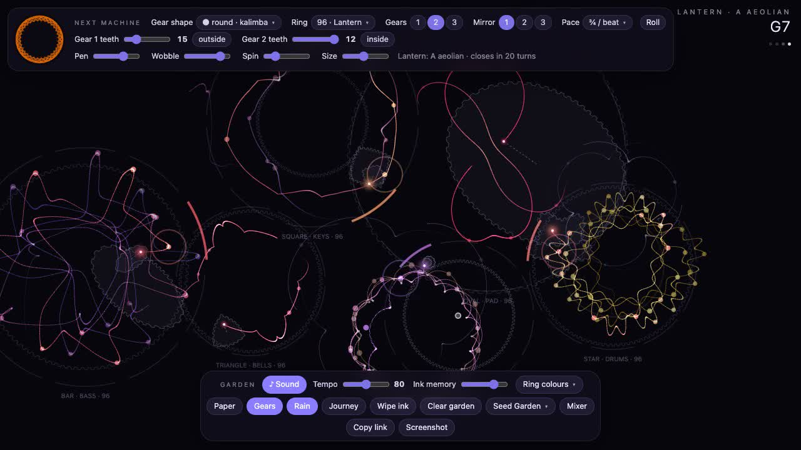

# Orbitals

A chill music toy made of spirographs. Every machine on the board is a ring with gears rolling inside it; the
pen draws the figure, and every outward swing of the pen plays a note. Plant a few machines and they become a band.

**[▶ Play it](https://vibdev.github.io/orbitals/)** · **[Watch the 12-second demo with sound](https://vibdev.github.io/orbitals/demo.mp4)**

[](https://vibdev.github.io/orbitals/demo.mp4)

## How it plays

Everything you hear comes from something you can see:

| Spirograph part | What it does to the music |
| --- | --- |
| Gear shape | The instrument: round kalimba, triangle bells, square keys, bar bass, oval pad, star drums |
| Ring size | The key and mood. The most common ring in the garden wins |
| Gear teeth, nested gears | The rhythm and the melody's pattern (for drums, the kick pattern) |
| Pen, Wobble | How far the pen swings: loudness, low notes, dynamics |
| Spin | Turns the figure each beat, so the melody walks to new notes |
| Size | Octave: much bigger plays lower, much smaller plays higher |
| Mirror | Extra pens that sing harmonies |
| Pace | Notes per beat |

Design a machine in the top bar and click empty space to plant it. Click a machine to re-gear it, shift-click to
pick its design up, right-click to remove it, drag to move it. The bottom bar holds settings for the whole garden.
**Copy link** gives a URL that reopens the exact garden.

## For agents: forking and working on this repo

This section is written for coding agents (and people) who want their own copy.

### Fork and run

```
gh repo fork vibdev/orbitals --clone
cd orbitals
open index.html          # macOS; any browser works, no server or build step
```

The whole app is `index.html`: one file, plain JavaScript, Web Audio, two canvases, no dependencies.
Do not add a framework or a bundler. Edit the file and reload.

To publish your fork on GitHub Pages:

```
gh api -X POST repos/{owner}/{repo}/pages -f 'source[branch]=main' -f 'source[path]=/'
```

It will be served at `https://<your-user>.github.io/orbitals/`. Update the links at the top of this README to match.

### Where things are in `index.html`

The script is in sections marked `// ---------- name ----------`. The ones that matter most:

- **settings**: `S`, the garden-wide settings.
- **harmony**: `MOODS`, `RINGS`, `moodOfRing`, `chordAt`, `voteMood`.
- **transport**: the beat clock locked to the audio clock (`beatPos`, `slotBeat`, `when`, `at`).
- **audio**: the mixer (`MIX`, `LEVEL`, `RAIN`), reverb, delay, and `SYN`, the synth for every sound.
- **voices**: `VOICES` (per-instrument timing), `SHAPES` (gear outline per instrument), `noteFor` (angle to pitch).
- **gear geometry**: `geometry(cfg, shape)` and `penXY(G, t, pen, rot)`. All drawing and all music read the pen from here.
- **machines**: `class Machine`. `measure()` tunes the gears to the tempo, `listen()` looks ahead for pen swings, `trigger()` turns one into a note on the beat grid, `draw()` inks it.
- **the next machine (top bar)**: the design object `D` and its controls. A planted machine is exactly `D`.
- **garden controls (bottom bar)**, **sharing** (`encodeGarden`, `decodeGarden`: the garden lives in the URL hash), and the custom dropdowns.

### Rules that keep it working

- Every knob must be audible. If you add a spirograph property, give it a musical meaning; if you add a musical feature, tie it to something visible on the board.
- Notes are always placed on the 16th-note grid through `trigger()`. Do not schedule sound from frame time.
- If you add a field to a machine's design, add it to `Machine.apply`, `Machine.design`, `encodeGarden` and `decodeGarden`, and keep old links loading.
- Dropdowns are drawn by the app, not the browser (native menus swallowed the next click). Add a `<select>` to the markup and it is converted automatically.

### Checking your work

You probably cannot hear the result, so measure it. `tools/` has a listening rig that plays a repeatable garden in
headless Chrome, records the mix and one stem per instrument, logs every note, and reports loudness, frequency
balance, note density and wrong-note clashes:

```
cd tools && npm install
node listen.js --preset "Full band" --seconds 30
```

See [tools/README.md](tools/README.md) for the options. Useful URL hooks: `index.html?seed=7` (repeatable gardens)
and `index.html?dev` (every note is logged to `NOTELOG`). Run the rig before and after any change to sound,
and compare the numbers rather than trusting the code.

### Sending changes back

Work on a branch in your fork and open a pull request against `vibdev/orbitals`. Say what changed for the
player, and include the before and after numbers from the listening rig if you touched the sound.

## Licence

[MIT](LICENSE)
